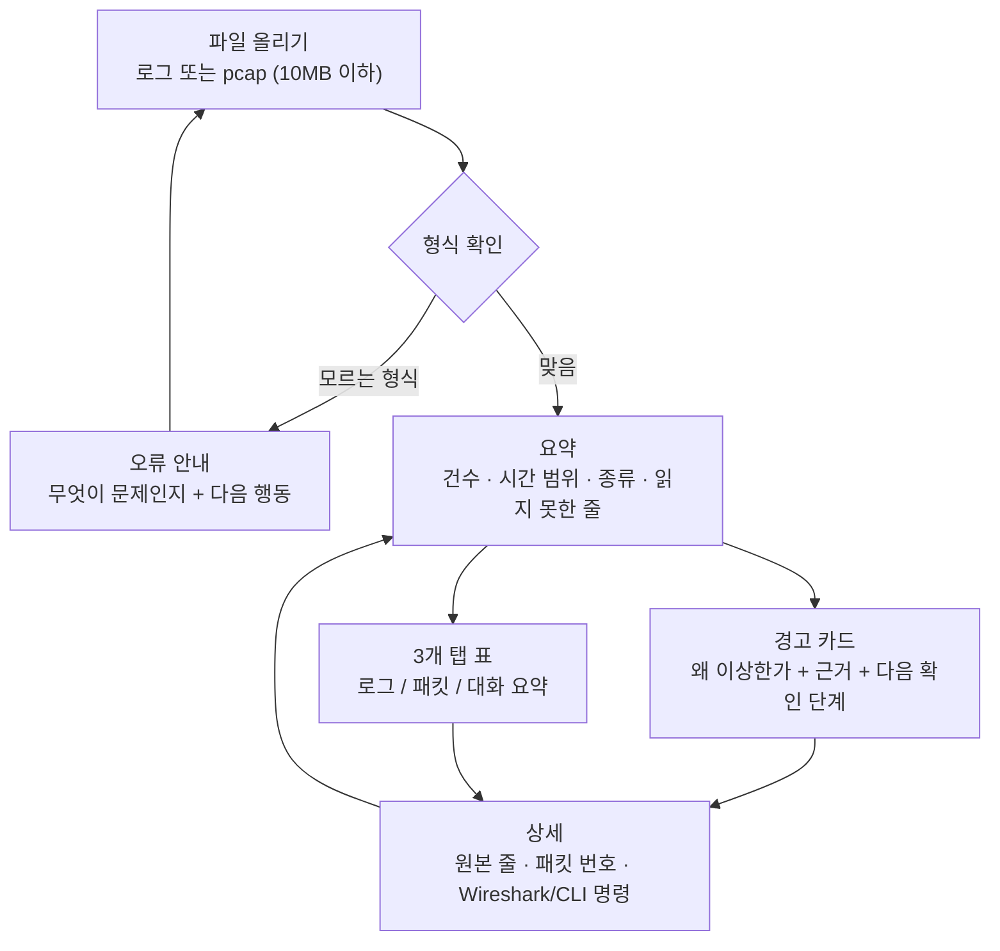

# easy-log-packet-analyzer UI/UX 설계

> 왜 필요한지: [why.md](why.md) · 핵심 기능: [features.md](features.md) · 설계: [design.md](design.md) · 샘플: [samples.md](samples.md)
> 이 문서는 화면 설계만 담습니다. 코드는 없습니다. 탭 이름과 용어는 [design.md](design.md) 4단계, [features.md](features.md)와 맞춥니다.

## 0. 먼저 알아 둘 말
- pcap: 네트워크 패킷(오가는 데이터 조각)을 저장한 파일. Wireshark가 주로 쓰는 형식.
- Streamlit: Python 코드만으로 웹 화면을 만드는 라이브러리. 이 도구의 화면은 Streamlit로 만듭니다.
- 탭: 한 화면 안에서 내용을 나눠 보는 칸. 여기서는 로그·패킷·대화 요약 세 칸.
- 대화(연결): 같은 두 컴퓨터가 주고받은 패킷을 하나로 묶은 것. Zeek의 conn.log와 같은 방식.
- 디스플레이 필터: Wireshark에서 원하는 패킷만 보이게 거르는 조건식 (예: `tcp.port == 22`).
- tshark: Wireshark의 명령줄 버전. 같은 필터를 터미널에서 씁니다.
- CSV: 쉼표로 칸을 나눈 표 파일. 엑셀로 열 수 있습니다.
- 대비(contrast): 글자색과 배경색이 얼마나 밝기 차이 나는지. 낮으면 읽기 어렵습니다.
- 포커스: 키보드 Tab 키로 지금 선택된 요소를 표시하는 테두리.

## 1. 대상 사용자
- 비전공자, 보안관제(SOC)를 공부하는 취업 준비생.
- Python을 조금 알지만 네트워크·로그 용어는 낯선 사람.
- 공개 샘플(몇 MB)로 연습하고, Wireshark·tshark로 넘어가고 싶은 사람.
- 목표 느낌: "정신없던 패킷 분석의 기초를 여기서 잡았다."
- 전문가용 고급 기능은 목표가 아닙니다. 실시간 감시·자동 차단·대용량은 다루지 않습니다.

## 2. 핵심 흐름
파일 올리기 → 요약 → 경고 카드 → 상세. 각 단계는 되돌아갈 수 있습니다.



규칙: 경고 카드는 항상 근거(원본 줄 번호 또는 패킷 번호)와 신뢰도(`근거 충분` / `더 확인 필요`)를 함께 보여 줍니다. 근거 없는 경고는 띄우지 않습니다.

## 3. 화면별 레이아웃
탭 이름은 [design.md](design.md) 4단계와 같게 **로그 탭**, **패킷 탭**, **대화 요약 탭** 세 개를 씁니다.

### 3.1 공통 뼈대 (파일 올리기 + 요약)
```text
┌──────────────────────────────────────────────────────────┐
│ easy-log-packet-analyzer                                 │
│ 로그와 패킷을 한곳에서, 쉬운 한국어로                    │
├──────────────────────────────────────────────────────────┤
│ [파일 올리기]  (끌어다 놓거나 클릭)                      │
│  지원: auth.log(sshd) · access.log · .evtx · .pcap/.pcapng│
│  최대 10MB                                               │
├──────────────────────────────────────────────────────────┤
│ 요약                                                     │
│  로그 2,000줄   패킷 38개   대화 8개   읽지 못한 줄 3개  │
│  시간 범위 10:00:00 ~ 10:12:30 (Asia/Seoul)              │
│  경고 2건  [근거 충분 1] [더 확인 필요 1]                │
├──────────────────────────────────────────────────────────┤
│ [ 로그 탭 ] [ 패킷 탭 ] [ 대화 요약 탭 ]                 │
│  (아래 3.2 ~ 3.4)                                        │
└──────────────────────────────────────────────────────────┘
```
- 요약 숫자는 `st.metric`으로 크게 보여 주고, 옆에 단위와 뜻을 한 줄로 붙입니다.
- 파일을 안 올렸으면 탭 대신 빈 상태 안내(5장)를 보여 줍니다.

### 3.2 로그 탭
```text
┌──────────────────────────────────────────────────────────┐
│ 경고 카드 (접기/펴기)                                     │
│  ⚠ 같은 IP의 SSH 로그인 실패 반복  [중간] [근거 충분]     │
│  왜: 1분 안에 비밀번호 실패 8번 → 무차별 대입일 수 있음   │
│  근거: auth.log 23~30번째 줄  [원본 보기]                 │
│  다음: ① 같은 IP의 Accepted 확인 ② 22번 포트 연결 수      │
│  Wireshark: ip.src == 203.0.113.5 && tcp.dstport == 22    │
│  Suricata 룰 예시 (참고용, 실행 안 함)                    │
├──────────────────────────────────────────────────────────┤
│ 열 고르기 ☑시간 ☑출발지 ☑사용자 ☐종류 ☑상태  [CSV]       │
│ 도움말: 각 열 이름 옆 [?]                                 │
├──────────────────────────────────────────────────────────┤
│ 시간      출발지          사용자  상태   요약             │
│ 10:02:15  203.0.113.5     root    404    Failed password  │
│ 10:02:16  203.0.113.5     root    404    Failed password  │
│ ...                                                      │
├──────────────────────────────────────────────────────────┤
│ 지금 보는 것: 203.0.113.5 SSH 실패                        │
│ awk로는: awk '{print $1, $4, $9}' access.log              │
│          형식이 다르면 칸 번호가 바뀝니다                 │
└──────────────────────────────────────────────────────────┘
```
- 한 줄을 고르면 같은 시각 앞뒤 몇 초를 **패킷 탭**에서 강조합니다. 단, Streamlit 탭은 코드로 전환할 수 없으므로(7장) "패킷 탭에서 강조해 두었습니다" 안내를 함께 띄웁니다.
- 오해 힌트(`hints.yaml`)는 경고가 아니라 별도 접기 상자로, 재전송·RST·DNS 실패 같은 정상 현상을 설명합니다.

### 3.3 패킷 탭
```text
┌──────────────────────────────────────────────────────────┐
│ 도움말: 번호·시간·출발지·목적지·프로토콜 옆 [?]            │
├──────────────────────────────────────────────────────────┤
│ 열 고르기 ☑번호 ☑시간 ☑출발지 ☑목적지 ☑포트 ☑종류 [CSV]  │
│ tshark로는: tshark -r sample.pcap -T fields -e ...        │
├──────────────────────────────────────────────────────────┤
│ 번호  시간              출발지          목적지         종류│
│ 1     10:02:14.100      192.168.170.8   192.168.170.20 UDP │
│ 2     10:02:14.250      ...                              │
│ (선택한 시간대 줄은 배경 + 아이콘 + '강조' 글자로 표시)   │
├──────────────────────────────────────────────────────────┤
│ 상세 (펼치기)                                             │
│  #1 Ethernet / IP / UDP / DNS                            │
│  계층별 필드 · 16진수 덤프 · 원본 패킷 번호               │
│  Wireshark에서는: frame.number == 1                       │
└──────────────────────────────────────────────────────────┘
```
- 강조는 색만 쓰지 않습니다. 배경색 + 아이콘 + "강조" 글자를 함께 씁니다.
- 패킷 번호는 Wireshark `frame.number`와 맞춥니다([design.md](design.md) 2단계).

### 3.4 대화 요약 탭
```text
┌──────────────────────────────────────────────────────────┐
│ 대화를 먼저 보고, 필요하면 패킷으로 내려갑니다            │
├──────────────────────────────────────────────────────────┤
│ 열 고르기 ☑대화 ☑출발지:포트 ☑목적지:포트 ☑종류 ☑상태    │
│ [+/-] [보낸 바이트] [받은 바이트] [지속 시간]             │
├──────────────────────────────────────────────────────────┤
│ 대화 C1  192.168.4.76:46378 → 31.3.245.133:80 (HTTP)      │
│          0.25초  보냄 77B / 받음 295B                     │
│ 상태: 정상 연결·정상 종료 (SF)                            │
│ 흐름: S h A D a d F f                                     │
│ Wireshark에서는: tcp.stream eq 0                          │
├──────────────────────────────────────────────────────────┤
│ 대화 C2  ...                                             │
└──────────────────────────────────────────────────────────┘
```
- 상태는 Zeek 표기(SF 등)와 쉬운 한국어를 같이 씁니다.
- 한 대화를 고르면 패킷 탭에서 그 대화 패킷만 강조합니다. 행 클릭 선택 지원 여부는 Streamlit 버전에 따라 다릅니다(7장, 확인 못 함).

### 3.5 경고 카드 상세 (모든 탭 공통, 펼치기)
```text
⚠ [분류: 정찰 시도]  [level: 중간]  [근거 충분]
제목: 짧은 시간에 여러 포트 접속 (포트 스캔 의심)
왜 이상한가: 60초 안에 서로 다른 포트 12개에 연결 시도
근거: 패킷 #15, #16, #18 ...  [원본 보기]
신뢰도 판단: 조건 모두 일치 · 근거 12개 · 원본에서 재확인됨
다음 확인 단계: ① 응답(SYN-ACK)이 온 포트가 있는지 ② 같은 IP의 로그
Wireshark에서는: ip.src == 203.0.113.5 && tcp.flags.syn == 1
Suricata 룰 예시 (참고용, 실행 안 함)
오해 주의: 정상 포트 점검 도구도 같은 모양이 될 수 있습니다.
```
- `더 확인 필요`일 때는 이유를 한 줄 붙입니다(예: "읽지 못한 줄 3개가 있어 근거가 일부 비었습니다").
- 색만으로 `level`을 구분하지 않습니다. 항상 `높음/중간/낮음` 글자를 씁니다.

## 4. 용어 설명 방식
- **한 줄 인라인 설명**: 열 이름·필드 옆 `[?]`를 누르면 `help.yaml`의 한 줄 설명과 "여기서 볼 것"을 보여 줍니다. Streamlit에서는 열 설정의 `help` 또는 작은 도움말 상자를 씁니다.
- **처음 나올 때 한 번 풀어 쓰기**: 표 머리글과 카드 첫 등장에 괄호로 쉬운 말을 붙입니다. 예: `재전송(retransmission: 상대가 못 받아 다시 보내는 것)`.
- **도움 가이드 화면**: 사이드바 또는 상단 "도움말"에 용어 목록, 읽는 순서, Wireshark로 넘어가는 방법을 모읍니다. 각 항목은 "뜻 / 여기서 볼 것 / Wireshark에서는" 3줄 구조.
- **같은 말 같은 뜻**: 화면·문서·CSV 머리글이 같은 용어를 씁니다. 영어 원어는 괄호 안에만 둡니다.
- 한 문장은 짧게, 전문 용어는 한 문장 안에 두 개 이상 넣지 않습니다.

## 5. 오류/빈 상태 문구 (그대로 쓰는 문구)
원칙: 무엇이 문제인지 + 왜인지 + 다음에 무엇을 하면 되는지. 오류에도 근거와 숫자를 넣습니다.

### 5.1 pcap이 아닌 파일
```text
제목: pcap 파일이 아닙니다
본문: 이 파일은 패킷을 저장한 pcap/pcapng 형식이 아닙니다.
      Wireshark에서 저장할 때 형식을 pcap 또는 pcapng로 고르거나,
      다른 파일을 올려 주세요.
행동: [다른 파일 올리기]
```

### 5.2 잘린 pcap
```text
제목: 파일 끝이 잘려 N개까지만 읽었습니다
본문: 파일을 끝까지 읽지 못했습니다. 읽은 N개 패킷만 보여 줍니다.
      마지막 패킷은 일부가 빠져 있을 수 있습니다.
      다시 받은 파일이면 새로 올려 주세요.
행동: [다시 올리기] [읽은 N개 보기]
```

### 5.3 파일이 10MB보다 큼
```text
제목: 파일이 너무 큽니다 (10MB 제한)
본문: 이 도구는 공부용이라 10MB까지만 읽습니다.
      Wireshark로 열어 일부만 저장하거나, 더 작은 공개 샘플을 올려 주세요.
행동: [다른 파일 올리기]
```

### 5.4 조건에 맞는 줄 없음
```text
제목: 조건에 맞는 줄이 없습니다
본문: 지금 필터에 맞는 로그/패킷이 0건입니다.
      필터를 지우거나, 시간 범위를 넓히거나, 다른 열을 골라 보세요.
행동: [필터 지우기]
```

### 5.5 모르는 로그 형식
```text
제목: 읽을 수 없는 로그 형식입니다
본문: 지금은 auth.log(sshd), Apache/Nginx access.log,
      Windows .evtx만 읽습니다. 이 파일에서 읽은 줄은 0줄입니다.
      지원 목록과 샘플 링크를 확인해 주세요.
행동: [지원 형식 보기] [다른 파일 올리기]
```

### 5.6 그 밖의 상태
- 파일 없음: `아직 파일이 없습니다` / `로그나 pcap 파일을 올리면 여기에 요약이 나옵니다.`
- 읽는 중: `파일을 읽는 중입니다…` + 진행 표시. 숫자가 나오기 전에는 빈 표를 보여 주지 않습니다.
- 일부만 읽음: `N줄을 읽지 못했습니다. 원본 줄 번호와 함께 보여 줍니다.`
- 데이터는 있지만 경고 없음: `규칙에 걸린 경고가 없습니다. 이것은 안전하다는 뜻이 아닙니다.`

## 6. 색/글꼴/접근성
- **대비**: 본문 글자 대비 4.5:1 이상. 큰 숫자·큰 제목도 3:1 이상을 목표로 하고, 구현 때 자동 검사합니다. 옅은 회색 글자는 배경 대비 부족하기 쉬우니 쓰지 않습니다.
- **색만으로 뜻 전달 금지**: 빨강/초록은 보조 신호입니다. 항상 아이콘 + 글자(`높음`, `낮음`, `강조`, `정상`, `위험`)를 함께 씁니다. 색을 못 보는 사람도 읽을 수 있어야 합니다.
- **이모지 금지**: 아이콘으로 이모지를 쓰지 않습니다. 선 아이콘(SVG)이나 글자 배지(`!`, `i`)를 씁니다.
- **키보드**: Tab 키로 모든 버튼·탭·입력에 닿고, 지금 위치가 보이는 포커스 테두리를 둡니다. 포커스를 없애지 않습니다.
- **핵심 숫자**: 건수·시간·패킷 번호는 크게, 자릿수가 흔들리지 않는 글꼴(고정폭 숫자)로 보여 줍니다.
- **레이아웃**: 375 / 768 / 1024 / 1440px에서 확인합니다. 좁을 때는 표를 가로 스크롤하고, 요약 카드는 한 줄에 하나씩 쌓습니다. 375px에서 가로 스크롤이 생기지 않게 합니다.
- **상태**: 로딩 · 빈 상태 · 오류를 모두 따로 설계합니다(5장). 오류는 화면을 지우지 않고 원인과 다음 행동을 남깁니다.
- **차분한 대시보드**: 시각적 변화(variance) 4/10, 움직임(motion) 3/10, 정보 밀도(density) 7/10. 화려한 효과보다 읽기 쉬운 표를 우선합니다. 애니메이션은 짧게, `prefers-reduced-motion`을 존중합니다.
- **금지**: 보라색 AI 그라데이션, 반짝이는 효과, 의미 없는 배경 그라데이션. 색은 중립 배경 + 한 가지 강조색(파랑/청록) + 경고(주황/빨강)로 제한합니다.
- **글꼴**: 한글은 시스템 기본(예: Apple SD Gothic Neo, Malgun Gothic) 우선. 숫자·명령은 고정폭 글꼴. 8장 결정 사항.

## 7. Streamlit 가능 여부
기준: Streamlit 최신 안정 버전 기준. 버전에 따라 달라질 수 있는 것은 `확인 못 함`으로 적었습니다.

| 요소 | 할 수 있는 것 | 할 수 없는 것 / 주의 | 확실성 |
|---|---|---|---|
| `st.tabs` | 탭 UI와 탭별 내용 표시 | **모든 탭 내용을 매 실행마다 한꺼번에 계산**합니다(숨은 탭도 실행). 코드로 특정 탭을 여는 공식 기능이 없고, URL로 탭을 지정하는 기본 기능도 없습니다. 그래서 "다른 탭으로 이동" 버튼은 탭 전환을 못 합니다. | 확실 |
| `st.file_uploader` | 끌어다 놓기/클릭 업로드, 여러 파일, `type`으로 확장자 제한 | 크기 제한은 `server.maxUploadSize`(MB, 기본 200)로 서버 전체에 적용됩니다. 10MB 제한은 이 값을 10으로 두면 됩니다. 업로드 후 파일 전체를 메모리로 읽으므로 부분 스트리밍 제어는 제한적입니다. | 확실 |
| `st.dataframe` | 표, 정렬, 열 이름/도움말/형식 설정(`st.column_config`), 가상 스크롤 | 셀 단위 색·툴팁을 자유롭게 바꾸는 것은 제한적입니다. 행 클릭 선택(`on_select`)은 최근 버전에 있으나 버전 차이가 있어 **확인 못 함**. CSV 내보내기는 `st.download_button`으로 따로 만듭니다. | 일부 확인 못 함 |
| `st.expander` | 접기/펴기 상자, `expanded`로 처음 펼침 여부 지정 | 렌더링 후 코드로 열고 닫기, 다른 상자와 연동, 탭 전환 같은 동작은 공식 지원이 없습니다. 접힌 상태에서도 안쪽 내용은 계산됩니다. | 확실 |
| `st.metric` | 큰 숫자와 증감 표시, `delta_color`로 색 방향 바꾸기/끄기 | 임의 색·아이콘 지정은 제한적입니다. 색만으로 증감을 알리지 말고 라벨에 "증가/감소"를 씁니다. | 확실 |
| 테마 설정 (`.streamlit/config.toml`의 `[theme]`) | 전역 `primaryColor`, `backgroundColor`, `secondaryBackgroundColor`, `textColor`, `font` 등 | 컴포넌트별 세부 색, 포커스 링 두께, 대비 자동 보장은 못 합니다. 커스텀 CSS는 `st.markdown(..., unsafe_allow_html=True)`로 가능하지만 공식 방식이 아니고 버전에 따라 깨질 수 있습니다. 정확한 옵션 목록은 **확인 못 함**. | 일부 확인 못 함 |

설계에 주는 영향:
- 탭 전환을 전제로 한 "이동" 버튼을 만들지 않습니다. 대신 같은 화면 안 강조 + "패킷 탭에서 강조해 두었습니다" 문구를 씁니다.
- 10MB 제한은 업로더가 아니라 서버 설정으로 겁니다. 화면에도 "최대 10MB"를 미리 적습니다.
- 대화 행 클릭 강조는 구현 때 Streamlit 버전을 확인하고, 안 되면 "이 대화 보기" 버튼으로 대체합니다.

## 8. 정해야 할 것 (2~3개)
### 결정 1. 시간 연결 강조를 어디서 보여 줄까
- A) 지금 탭에 강조 결과와 안내 문구를 같이 보여 준다.
- B) 강조만 보는 별도 화면으로 이동한다.
- 추천: **A**. Streamlit 탭은 코드로 바꿀 수 없어서, 이동 버튼을 만들면 기대와 다르게 동작합니다.

### 결정 2. 경고 카드를 어디에 둘까
- A) 각 탭 위에 접을 수 있는 카드로 두고, 상세는 펼쳐서 본다.
- B) 탭을 하나 더 만들어 "경고" 탭에 모아 둔다.
- 추천: **A**. 탭 3개 이름을 [design.md](design.md)와 맞출 수 있고, 표를 보면서 경고를 바로 확인할 수 있습니다. B는 탭 구조가 바뀌어 문서와 충돌합니다.

### 결정 3. 글꼴을 어떻게 할까
- A) 운영체제 기본 글꼴을 쓴다.
- B) Pretendard 같은 웹 글꼴 파일을 직접 넣는다.
- 추천: **A**. 설치가 필요 없고 가장 빨리 뜨며, 한글 읽기에 충분합니다. 디자인 통일이 꼭 필요해지면 B로 바꿉니다.
